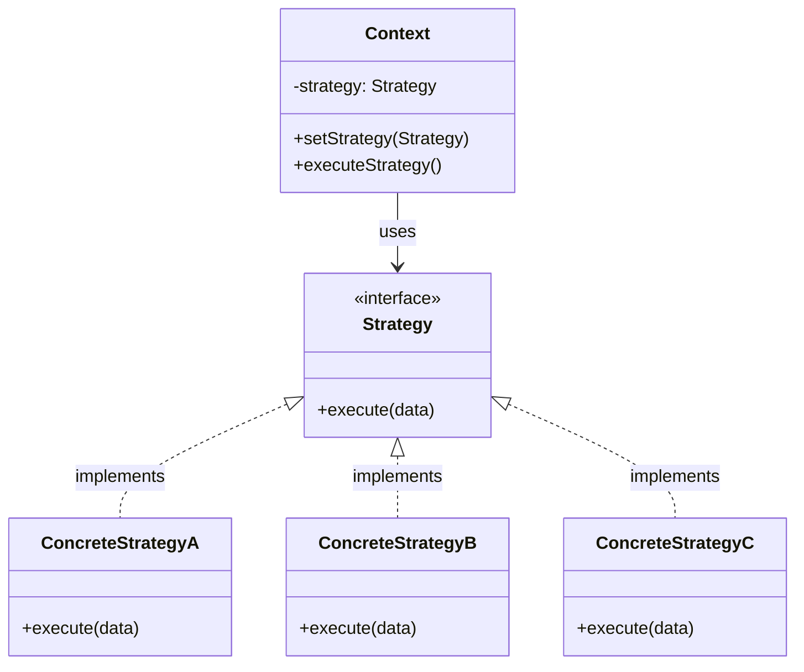

# EVSA

## Design Patterns
### Strategy Pattern
Die Idee: Stelle dir eine Klasse für einen Spielcharakter vor. Dieser hat ein Schwert, mit welchem er zuschlagen kann. Der staight-forward Weg währe, eine `Character.swing_sword()` Methode einzubringen. Jetzt wird dir allerdings gesagt, dass er auf einmal auch andere Schwerter Nutzen kann. Wahrscheinlich würdest du den Code jetzt so anpassen, dass man in die `swing_sword()` Methode nun einfach das spezifische Schwert dazugibt, also `Character.swing_sword(Sword)`. Weil das allerdings nicht genug ist, wird die jetzt gesagt, dass er nicht nur unterschiedliche Schwerter nutzen soll, sondern auch Waffen. Dir ist klar, dass `Character.swing_sword(Weapon)` nicht wie vorgesehen funktionieren wird. Also fügst du neben `Character.swing_sword(Sword)` noch `Character.shoot(Weapon)`. Wenn der Spieler jetzt die Maustaste zum Angreifen klickt, musst du also erstmal gucken, ob er jetzt eine Waffe oder ein Schwert in der Hand hat e.g.
```python
class Character:
	current_weapon: AssaultRifle | Sword
	
	def on_attack_click(self):
        if isinstance(self.current_weapon, Sword):
            self.swing_sword(self.current_weapon)
            
        elif isinstance(self.current_weapon, AssaultRifle):
            self.shoot(self.current_weapon)
            
        else:
	        raise RuntimeError("Weapontype unknown")


    def swing_sword(self, sword: Sword): ...
    def shoot(self, weapon: AssaultRifle): ...
```
Schön. Wir haben einen Charakter, der sowohl mit Schusswaffen als auch Schwertern umgehen kann. Nun wird der allerdings gesagt, dass wir auch gerne Bögen hatten, die man unterschiedlich stark spannen kann und Magiewaffen wären auch nicht schlecht. Du fügst also noch `Character.use_magic_rod(Rod)` und `Character.draw_bow(Bow)` ein. Die `on_attack_click()` Methode muss also nun schon zwischen 4 Waffentypen unterscheiden.

An diesem Punkt wäre die saubere Lösung das Strategy Pattern gewesen. Hier hätten wir eine Strategie für jede Waffe einbauen können. Jede Strategie hätte dann eine `Strategy.execute()` Methode, die dafür sorgt, dass die Waffe wie vorgesehen benutzt wird. Die `SwordStrategy` würde das Schwert schwingen, die `AssaultRifleStragety.execute()` würde einen Schuss abgeben usw. Die `Character`Klasse könnte nun ein neues Feld `Character.weapon_strategy: Strategy` bekommen, und sobald der Spieler klickt, müssen wir nur noch `weapon_stragey.execute()` ausführen. Das ganze würde in etwa so aussehen: 
```python
from abc import ABC, abstractmethod

# Jede Strategie soll eine execute() Methode haben
class AttackStrategy(ABC):
    @abstractmethod
    def execute(self) -> None:
        ...

class SwordStrategy(AttackStrategy):
    def execute(self) -> None:
        print("Schwert geschwungen")

class AssaultRifleStrategy(AttackStrategy):
    def execute(self) -> None:
        print("Salve abgefeuert")

class BowStrategy(AttackStrategy):
    def execute(self) -> None:
        print("Pfeil abgeschossen")

class MagicRodStrategy(AttackStrategy):
    def execute(self) -> None:
        print("Zauber ausgelöst")


class Character:
    def __init__(self, weapon_strategy: AttackStrategy):
        self.weapon_strategy = weapon_strategy  # just pass in the strat

    def on_attack_click(self) -> None:
        self.weapon_strategy.execute()  # one line, always works
        
c = Charakter()
sword = SwordStragety()
c.weapon = sword
c.on_attack_click()  # Schwert geschwungen
bow = BowStragety()
c.weapon = bow  
c.on_attack_click()  # Pfeil abgeschossen
```
Formal würde das ganze wie folgt aussehen: 
`Context` wäre der `Character`, `Stragety` wäre `AttackStragety`, und ConcreteStragetyA .. ConcreteStragetyC wären die jeweiligen Waffenimplementierungen. 
Das was wir davon haben, sind während der Laufzeit austauschbare Algorithmen. Ein Lieferservice könnte so Beispielsweise Strategien für die unterschiedlichen Lieferdienste erstellen. Also `DhlStrategy`, `UpsStragety`, `HermesStrategy`, ... eben da alle ein Stück anders funktionieren werden, aber irgendwo schon ähnlich sind.



### Observer Pattern


