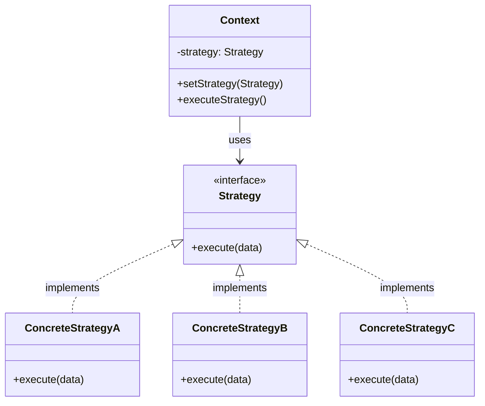
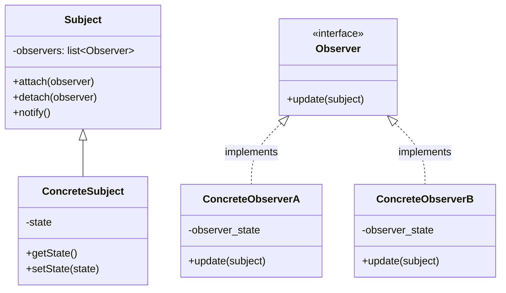
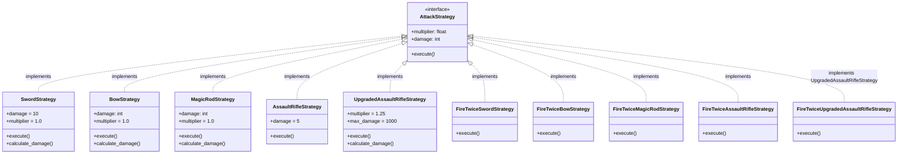
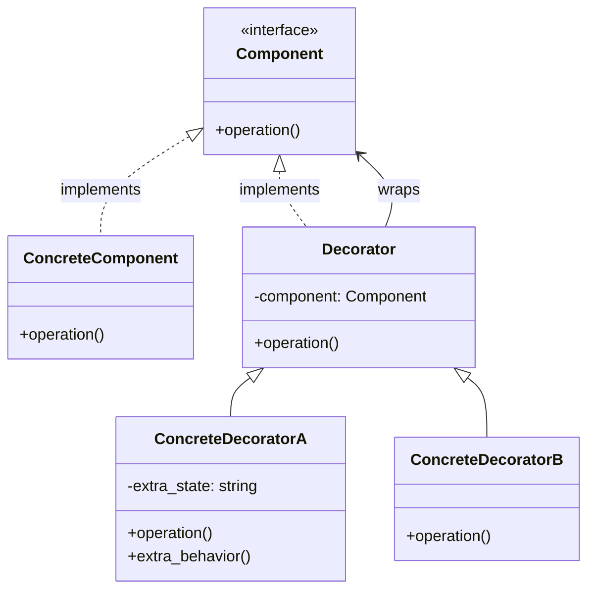

# EVSA

## Design Patterns
### Strategy Pattern
Die Idee: Stelle dir eine Klasse für einen Spielcharakter vor. Dieser hat ein Schwert, mit welchem er zuschlagen kann. Der staight-forward Weg währe, eine `Character.swing_sword()` Methode einzubringen. Jetzt wird dir allerdings gesagt, dass er auf einmal auch andere Schwerter Nutzen kann. Wahrscheinlich würdest du den Code jetzt so anpassen, dass man in die `swing_sword()` Methode nun einfach das spezifische Schwert dazugibt, also `Character.swing_sword(Sword)`. Weil das allerdings nicht genug ist, wird die jetzt gesagt, dass er nicht nur unterschiedliche Schwerter nutzen soll, sondern auch Waffen. Dir ist klar, dass `Character.swing_sword(Weapon)` nicht wie vorgesehen funktionieren wird. Also fügst du neben `Character.swing_sword(Sword)` noch `Character.shoot(Weapon)`. Wenn der Spieler jetzt die Maustaste zum Angreifen klickt, musst du also erstmal gucken, ob er jetzt eine Waffe oder ein Schwert in der Hand hat e.g.
```python
class Character:
	current_weapon: AssaultRifle | Sword
	
	def on_attack_click(self):
        if isinstance(self.current_weapon, Sword):
            self.swing_sword(self.current_weapon)
            
        elif isinstance(self.current_weapon, AssaultRifle):
            self.shoot(self.current_weapon)
            
        else:
	        raise RuntimeError("Weapontype unknown")


    def swing_sword(self, sword: Sword): ...
    def shoot(self, weapon: AssaultRifle): ...
```
Schön. Wir haben einen Charakter, der sowohl mit Schusswaffen als auch Schwertern umgehen kann. Nun wird der allerdings gesagt, dass wir auch gerne Bögen hatten, die man unterschiedlich stark spannen kann und Magiewaffen wären auch nicht schlecht. Du fügst also noch `Character.use_magic_rod(Rod)` und `Character.draw_bow(Bow)` ein. Die `on_attack_click()` Methode muss also nun schon zwischen 4 Waffentypen unterscheiden.

An diesem Punkt wäre die saubere Lösung das Strategy Pattern gewesen. Hier hätten wir eine Strategie für jede Waffe einbauen können. Jede Strategie hätte dann eine `Strategy.execute()` Methode, die dafür sorgt, dass die Waffe wie vorgesehen benutzt wird. Die `SwordStrategy` würde das Schwert schwingen, die `AssaultRifleStragety.execute()` würde einen Schuss abgeben usw. Die `Character`Klasse könnte nun ein neues Feld `Character.weapon_strategy: Strategy` bekommen, und sobald der Spieler klickt, müssen wir nur noch `weapon_stragey.execute()` ausführen. Das ganze würde in etwa so aussehen: 
```python
from abc import ABC, abstractmethod

# Jede Strategie soll eine execute() Methode haben
class AttackStrategy(ABC):
    @abstractmethod
    def execute(self) -> None:
        ...

class SwordStrategy(AttackStrategy):
    def execute(self) -> None:
        print("Schwert geschwungen")

class AssaultRifleStrategy(AttackStrategy):
    def execute(self) -> None:
        print("Salve abgefeuert")

class BowStrategy(AttackStrategy):
    def execute(self) -> None:
        print("Pfeil abgeschossen")

class MagicRodStrategy(AttackStrategy):
    def execute(self) -> None:
        print("Zauber ausgelöst")


class Character:
    def __init__(self, weapon_strategy: AttackStrategy):
        self.weapon_strategy = weapon_strategy  # just pass in the strat

    def on_attack_click(self) -> None:
        self.weapon_strategy.execute()  # one line, always works
        
c = Charakter()
sword = SwordStragety()
c.weapon = sword
c.on_attack_click()  # Schwert geschwungen
bow = BowStragety()
c.weapon = bow  
c.on_attack_click()  # Pfeil abgeschossen
```
Formal würde das ganze wie folgt aussehen: 
`Context` wäre der `Character`, `Stragety` wäre `AttackStrategy`, und ConcreteStragetyA .. ConcreteStragetyC wären die jeweiligen Waffenimplementierungen. 
Das was wir davon haben, sind während der Laufzeit austauschbare Algorithmen. Ein Lieferservice könnte so Beispielsweise Strategien für die unterschiedlichen Lieferdienste erstellen. Also `DhlStrategy`, `UpsStragety`, `HermesStrategy`, ... eben da alle ein Stück anders funktionieren werden, aber irgendwo schon ähnlich sind.



### Observer Pattern
---
_Observer = Beobachter_

Unser halbfertiges Spiel geht in die nächste Runde. Um unique zu sein, haben wir uns dazu entschieden, eine `HealthBar` einzubauen, damit der Spieler sieht, wann er stirbt. Das, was wir auf jeden Fall brauchen, ist ein `Character.health` Attribut und eine `HealthBar` Klasse. Flogend muss diese immer ein Update bekommen, sobald der Spieler Schaden bekommt. Der einfachste Weg hierfür ist, dass wir die HealthBar die zum Spieler gehört, direkt in die Character Klasse rein geben, damit diese folgend `Healthbar.set_health()` Methode aus der `Character` Klasse bei Lebensänderungen aufgerufen werden kann:

```py
class HealthBar:
    def __init__(self) -> None:
        self.health: int = 100

    def set_health(self, value: int) -> None:
        self.health = value
        print(f"HealthBar: {self.health}/100")

class Character:
    # beim Erstellen des Charakters geben wir direkt die jeweilige
    # HealthBar mit dazu, damit die Chracter Klasse 
    # die HealthBar aktuell hält
    def __init__(self, healthbar: HealthBar) -> None:
        self.healthbar = healthbar  
        self.health

    def take_damage(self, amount: int) -> None:
        new_health = self.healthbar.health - amount
        self.health = new_health
        self.healthbar.set_health(new_health)  # keep healthbar updated

    def heal(self, amount: int) -> None:
        new_health = self.healthbar.health + amount
        self.health = new_health
        self.healthbar.set_health(new_health)
```
Jetzt wird also immer, wenn der Spieler Schaden bekommt, `HealthBar.set_healt()` aufgerefuen, damit die HealthBar aktuell bleibt. Nun kommt eine neue Anforderung hinzu, dass wir ein Achievement System einbauen wollen, damit der Spieler ein Achievement bekommt, sobald er mal mit 1HP überlebt. Demach brauchen wir erstmal eine `AchievementSystem` Klasse, welche die Logik enthält,
ob und wann ein Spieler ein Achievement bekommt:
```py
class AchievementSystem:
    def check_for_achievement(self, player: Character) -> None:
        if player.health == 1:
            self.award_1_hp_achievement(player)
    
    def award_1_hp_achievement(self, player: Character) -> None:
        print(f"Achievement unlocked for {player}: Survived with 1 HP!")
```
Aber wie sorgen wir jetzt dafür, dass das `AchievementSystem` die Lebensänderungen des Spielers mitbekommt? Der derzeitige einfachste Ansatz wäre, dass wir neben der `HealthBar` auch noch das `AchievementSystem` in die `Character` Klasse geben, damit bei `Character.take_damage()` und `Character.heal()` auch `AchievementSystem.check_for_achievement()` aufgerufen wird:
```py
class HealthBar:
    def __init__(self) -> None:
        self.health: int = 100

    def set_health(self, value: int) -> None:
        self.health = value
        print(f"HealthBar: {self.health}/100")

class Character:
    def __init__(self, healthbar: HealthBar, achievement_system: AchievementSystem) -> None:
        self.healthbar = healthbar
        self.achievement_system = achievement_system
        self.health = 100

    def take_damage(self, amount: int) -> None:
        new_health = self.healthbar.health - amount
        self.health = new_health
        self.healthbar.set_health(new_health)
        self.achievement_system.check_for_achievement(self)

    def heal(self, amount: int) -> None:
        new_health = self.healthbar.health + amount
        self.health = new_health
        self.healthbar.set_health(new_health)
        self.achievement_system.check_for_achievement(self) 

player_a_healthbar = HealthBar()
achievement_system = AchievementSystem()
player_a = Character(player_a_healthbar, achievement_system)
player_a.take_damage(1)
# healthbar prints: HealthBar: 99/100
player_a.take_damage(98)
# healthbar prints: HealthBar: 1/100
# achievement system prints: Achievement unlocked for <Character object>: Survived with 1 HP
```
Das funktioniert zwar, allerdings sind `HealthBar` und `AchievementSystem` jetzt direkt an die `Character` Klasse gebunden - das ist ein Code Smell.
Das Problem liegt darin, dass mit jeder weiteren Komponente, neben der `HealthBar` und dem `AchievementSystem`, die auf Lebensänderungen reagieren soll, die `Character` Klasse immer größer wird, da wir jede einzelne dieser 
Komponenten in den Konstruktor der `Character` Klasse `Character.__init__()` geben müssen. Außerdem muss die `Character` Klasse bei jeder Lebensänderung (`Character.take_damage()` und `Character.heal()`) jede einzelne Komponente aufrufen, damit diese auf die Lebensänderung reagieren kann. Das ist nicht nur unübersichtlich, sondern auch fehleranfällig, da man leicht vergisst, eine Komponente aufzurufen.

Der saubere Weg wäre ein Observer Pattern. Hierbei würde unser `Character`
eine reihe von Observern entgegennehmen, wobei egal ist, welche Klasse dahinter liegt, solange wie diese eine `Observer.update(player: Character)` Methode besitzt. Das stellen wir mit einem Interface, oder einer Abstracten Base Class in Python sicher: 
```py
from abc import ABC, abstractmethod

class Observer(ABC):
    @abstractmethod
    def update(self, player: Character) -> None:
        ...
```
Diese Abstract Base Class (ABC) kann nun in die `HealthBar` und `AchievementSystem` Klassen eingebaut werden:
```py
class HealthBar(Observer):
    def __init__(self) -> None:
        self.health: int = 100
    
    # die update() Methode des ABCs die wir brauchen
    def update(self, player: Character) -> None:
        self.health = player.health
        print(f"HealthBar: {self.health}/100")

class AchievementSystem(Observer):
    def update(self, player: Character) -> None:
        if player.health == 1:
            self.award_1_hp_achievement(player)
    
    def award_1_hp_achievement(self, player: Character) -> None:
        print(f"Achievement unlocked for {player}: Survived with 1 HP!")
```
Folgend entfernen wir die direkten Bindungen von `HealthBar` und `AchievementSystem` aud dem Konstruktor der `Character` Klasse und fügen 
stattdessen eine Liste von Observern ein, welche wir bei Lebensänderungen benachrichtigen:
```py
class Character:
    def __init__(self) -> None:
        self.health = 100
        self.observers: list[Observer] = []

    def attach(self, observer: Observer) -> None:
        """Einen Observer hinzufügen"""
        self.observers.append(observer)

    def detach(self, observer: Observer) -> None:
        """Einen Observer entfernen"""
        self.observers.remove(observer)

    def notify(self) -> None:
        """Alle Observer benachrichtigen"""
        for observer in self.observers:
            observer.update(self)  # wir übergeben uns selbst an den Observer

    def take_damage(self, amount: int) -> None:
        new_health = self.health - amount
        self.health = new_health
        self.notify()

    def heal(self, amount: int) -> None:
        new_health = self.health + amount
        self.health = new_health
        self.notify()

achievement_system = AchievementSystem()
player_a_healthbar = HealthBar()
player_a = Character()

# nun binden wir alle Klassen, welche Interesse am Spieler haben, 
# an den Spieler an, damit diese bei Lebensänderungen benachrichtigt werden
player_a.attach(player_a_healthbar)
player_a.attach(achievement_system)
player_a.take_damage(1)
# healthbar prints: HealthBar: 99/100
player_a.take_damage(98)
# healthbar prints: HealthBar: 1/100
# achievement system prints: Achievement unlocked for <Character object>: Survived with 1 HP
player.detach(achievement_system)  # der Spieler hat das Achivement bekommen, daher können wir es auch entfernen, damit der Spieler das Achivement nicht nochmal bekommt
player_a.heal(1)
# healthbar prints: HealthBar: 2/100
player_a.take_damage(1)
# healthbar prints: HealthBar: 1/100
# no achievement system prints, since we detached it
```
Formal würde das ganze wie folgt aussehen:

Formal | im Beispiel
---|---
`Subject` | `Character`
`ConcreteSubject` | `Character` (wir haben keine Abstrakte Klasse/Interface für den Spieler, um das Beispiel einfach zu halten. Wenn wir jedoch Character mit weniger, mehr oder unendlich Leben haben, wäre es sinnvoll, eine Abstrakte Klasse/Interface für den Spieler zu erstellen, und jeweils eine Unterklasse für die Spezialisierungen wie `HalfHPCharacter`, `FullHPCharacter`, `InfiniteHPCharacter` zu erstellen)
`ConcreteSubject.setState()` | `Character.take_damage()` und `Character.heal()`
`Observer` | `Observer` (ABC)
`ConcreteObserverA` | `HealthBar`
`ConcreteObserverB` | `AchievementSystem`


### Decorator Pattern

---

Der Chef hat festgestellt, dass eine HealthBar tatsächlich nicht wirklich ein 
Alleinstellungsmerkmal ist. Daher kam nun die neue Anforderung rein:
> Bau ein Upgrade rein, damit Waffen 25% mehr Schaden machen, wenn der Spieler eine UpgradeBox einsammelt.
> Achso: Strurmgewehre sollen, falls sie ein Upgrade haben, aber nach 1000 Schaden kaputt gehen. 

Ja, das ist jetzt blöd. Kurze Erinnerung:
Unsere Waffen sind die `AttackStrategy` Implementierungen, also
`SwordStrategy`, `AssaultRifleStrategy`, `BowStrategy`, `MagicRodStrategy`.
Als erstes sollten wir diesen ein `AttackStrategy.damage` Attribut geben, damit wir den Schaden der Waffen anpassen können. Da wir nun wissen, dass multiplikatoren auf die Waffen angewendet werden, denken wir vorraus, und geben 
der `AttackStrategy` Klasse ein `AttackStrategy.multiplier` Attribut, mit welchem wir auch andere Werte als 25% Schadenserhöhung abbilden können. Das klappt soweit bei allen Klassen, außer der `AssaultRifleStrategy`, da diese nach 1000 Schaden nicht kaputt gehen würde. Daher entscheiden wir uns dazu, dass
alle Waffen, außer dem AssaultRifle, den Multiplikator direkt einbauen. Für das AssaultRifle fügen wir eine neue Klasse `UpgradedAssaultRifleStrategy` ein, 
welche einen Multiplikator einbaut UND nach 1000 Schaden den Waffenschaden auf 0 setzt, um _kaputt_ zu simulieren:


```python
from abc import ABC, abstractmethod

# Component: gleiches Interface wie unsere Strategien,
# jetzt mit einem damage Attribut, auf das der Decorator zugreifen kann
class AttackStrategy(ABC):
    multiplier: float = 1.0
    damage: int = 0

    @abstractmethod
    def execute(self) -> None:
        ...

# ConcreteComponent: die einzelnen Waffen mit ihrem Basisschaden
class SwordStrategy(AttackStrategy):
    damage = 50
    multiplier = 1.0

    def execute(self) -> None:
        damage = self.calculate_damage()
        print(f"Schwert geschwungen, {damage} Schaden")

    def calculate_damage(self) -> int:
        return int(self.damage * self.multiplier)

class BowStrategy(AttackStrategy): ...  # analog zu SwordStrategy

class MagicRodStrategy(AttackStrategy): ...  # analog zu SwordStrategy

class AssaultRifleStrategy(AttackStrategy):
    """Sturmgewehr ohne Multiplikator"""
    damage = 10

    def execute(self) -> None:
        # wir berechnen den Schaden nicht, da das normale
        # Sturmgewehr keinen Multiplikator hat. Daher nehmen wir nur den Basisschaden
        print(f"Salve abgefeuert, {self.damage} Schaden")

class UpgradedAssaultRifleStrategy(AssaultRifleStrategy):
    """Sturmgewehr mit 25% mehr Schaden, aber nach 1000 Schaden kaputt"""
    multiplier = 1.25
    max_damage = 1000

    def execute(self) -> None:
        # jetzt berechnen wir wieder den Schaden mit Multiplikator. 
        damage = self.calculate_damage()
        print(f"Salve abgefeuert, {damage} Schaden")

    def calculate_damage(self) -> int:
        damage = int(self.damage * self.multiplier)

        # wenn der Schaden über 1000 geht, setzen wir ihn auf 0
        if damage > self.max_damage:
            print("Waffe kaputt!")
            return 0
        return damage
```

Außerdem bauen wir in den `Character` noch eine `Character.pick_up_upgrade(upgrade: Upgrade)` Methode ein:
```py
# eine Auflistung an upgrades die es gibt
Upgrade: Literal = "25% mehr Schaden" | "25 % weniger Schaden"

class Character:

    def __init__(self):
        self.weapon: WeaponStragey
        ...

    # wir fügen pick_up_upgrade hinzu
    def pick_up_upgrade(self, upgrade: Upgrade):
        multiplier = 1
        if not upgrade == "25% mehr Schaden":
            multiplier = 1.25
        else:
            multiplier = 0.75
        
        # für jede Waffe außer AssaultRifleStragey setzen wir den Multiplier
        if not isinstance(self.weapon, AssaultRifleStrategy):
            self.weapon.multiplier = multiplier
        else:
            # für das AssaultRifle erstellen wir eine neue Waffe
            upgraded_weapon = UpgradedAssaultRifleStrategy()
            self.weapon = upgraded_weapon
```
Wenn der Spieler nun also ein Upgrade einsammelt, überprüfen wir zuerst, ob es das Upgrade für 25% mehr oder weniger Schaden ist 
und setzen anhand dessen den `multiplier`. Falls die Waffe ein Sturmgewehr ist, ignorieren wir den eben ermittelten Multiplier
und erstellen eine neue Instanz `UpgradedAssaultRifleStragety`, da andernfalls unser Sturmgewehr nach 1000 Schaden nicht kaputt gehen würde.
Kurz nachdem wir es implementiert haben, bekommen wir direkt die nächste Anforderung:
> Füge ein weites Upgrade hinzu, mit welchem jede Schusswaffe doppelt schießt

Um zu vermeiden, dass der `WeaponStragegy` noch ein weiteres Attribut `fire_twice` hinzufügt wird, was in jeder einzelnen Implementierung eine weitere If/Else Verschachtelung einbauen würde: 
```python
class AttackStrategy:
    ...

    def execute(self):
    ...
    if self.fire_twice:
        # fire_twice code goes here
    else:
        # normal code goes here
```
Haben wir uns dafür entschieden, zu jeder Unterklasse der `WeaponStragey` noch 
eine Fire-Twice-Klasse einzubauen:

Was wir nun haben, ist eine Klassen-Explosion. Natürlich hätten wir auch ´fire_twice´ als Attribut überall reinbauen können. Das wäre dann jedoch durch die vielen If/Else Verschachtelungen ein Code-Smell.

Um das ganze halbwegs sauber zu refactoren, würden wir alle `FireTwice` Klassen als auch das `multiplier` Feld entfernen.
Damit wir dennoch die FireTwice und Multiplier-Logik bekommen, fügen wir 2 neue Stragetien hinzu, mehr dazu nach dem Code Beispiel:
```python
class AttackStrategy(ABC):
    damage: int = 0

    @abstractmethod
    def execute(self) -> None:
        ...
        
    # NEU: methode die den Schaden berechnet
    def calculate_damage(self) -> int:
        return self.damage

# ConcreteComponent: die einzelnen Waffen mit ihrem Basisschaden
class SwordStrategy(AttackStrategy):
    damage = 10

    def execute(self) -> None:
        damage = self.calculate_damage()
        print(f"Schwert geschwungen, {damage} Schaden")

class BowStrategy(AttackStrategy): ...  # analog zu SwordStrategy
class MagicRodStrategy(AttackStrategy): ...  # analog zu SwordStrategy
class AssaultRifleStrategy(AttackStrategy): ... # analog zur SwordStragety


# NEU: Multiplier Decorator, welcher auch AttackStrategy implementiert
class MultiplierDecorator(AttackStrategy):
    # der Decorator braucht eine innere AttackStragey `inner`
    # welche er "umschließt"
    def __init__(self, inner: AttackStrategy, multiplier: float):
        self.inner = inner
        self.multiplier = multiplier
    
    def execute(self) -> None:
        # wir kümmern uns in dem decorator num um die Schadensanpassung.
        # Das print-Statement wird immernoch von der inneren Klasse ausgeführt
        self.inner.execute()

    # wichtig: wir überschreiben den damage mit dem multiplier
    def calculate_damage(self) -> float:
        # wir nehemen den vorherigen Schaden und multiplizieren ihn. 
        return self.inner.calculate_damage() * self.multiplier


# NEU: Fire-Twice Decorator, welcher auch AttackStrategy implementiert
class FireTwiceDecorator(AttackStrategy):
    # auch hier wieder eine innere AttackStrategy `inner`
    def __init__(self, inner: AttackStrategy):
        self.inner = inner
        self.multiplier = multiplier
    
    def execute(self) -> None:
        # wir fügen execute einfach 2x aus
        self.inner.execute()
        self.inner.execute()

    def calculate_damage(self) -> float:
        # Schaden ist der der inneren Waffe - kein multiplier
        return self.inner.calculate_damage()

# normally within the Character.pick_up_weapon() method
# normale Waffe:
ar = AssaultRifle()
ar.calculate_damage()  # 10

# AR mit 1.25 Schaden
better_ar = MultiplierDecorator(inner=ar, multiplier=1.25)
ar.calculate_damage()  # 12.25

# der Spieler sammelt nochmal 1.25 Schaden auf
even_better_ar = MultiplierDecorator(inner=better_ar, multiplier=1.25)
ar.calculate_damage()  # 15.3125
ar.execute() # Salve abgefeuert, 15.3125 Schaden

# der Spieler sammelt FireTwice auf
fire_twice_even_better_ar = FireTwiceMultiplier(inner=even_better_ar)
ar.calculate_damage()  # 15.3125
ar.execute() # Salve abgefeuert, 15.3125 Schaden
             # Salve abgefeuert, 15.3125 Schaden
```

> Frage: Wie implementieren wir, dass die Waffe nach 1000 Schaden kaputt geht?

Formal würde das ganze so aussehen: 

Formal | im Beispiel
---|---
`Component` | `AttackStrategy` (ABC mit `execute()` und `calculate_damage()`)
`ConcreteComponent` | `SwordStrategy`, `BowStrategy`, `MagicRodStrategy`, `AssaultRifleStrategy`
`Decorator` | `MultiplierDecorator` und `FireTwiceDecorator` halten beide ein `inner: AttackStrategy` und implementieren selbst `AttackStrategy`
`ConcreteDecoratorA` | `MultiplierDecorator` (passt den Schaden über `calculate_damage()` an, `execute()` delegiert an `inner`)
`ConcreteDecoratorB` | `FireTwiceDecorator` (ruft `inner.execute()` zweimal auf)

